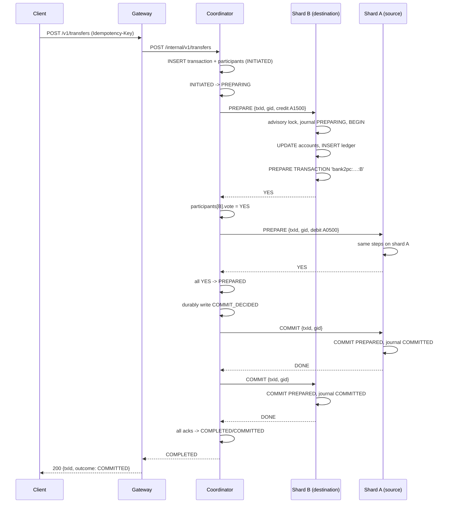
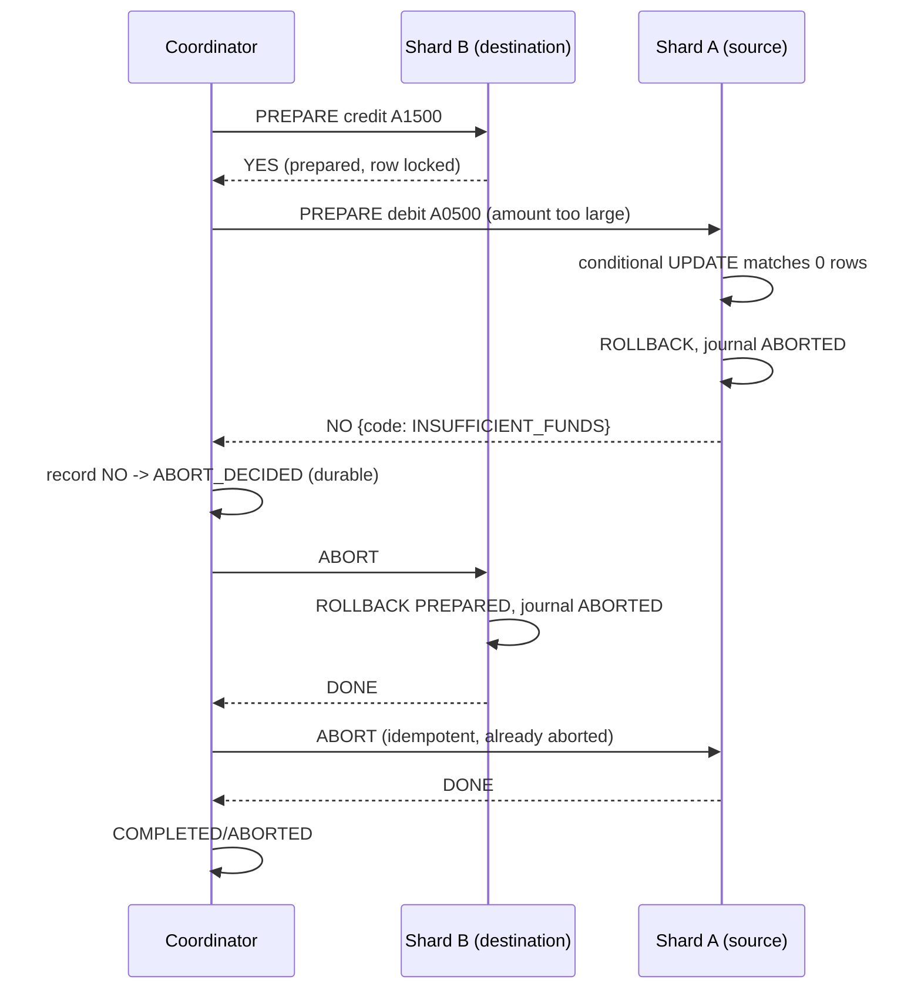

# Two-Phase Commit Protocol

This document describes the exact protocol, the durable state it relies on, and
why every failure scenario required by the assignment converges to a correct
outcome.

## 1. Roles and identifiers

| Term | Meaning |
| --- | --- |
| Coordinator | The single `coordinator` container. Owns the transaction journal and the decision. |
| Participant | A shard participating in a transaction. Exactly two for a cross-shard transfer. |
| `txId` | UUID generated by the coordinator. Identifies the distributed transaction. |
| `gid` | `bank2pc:<txId>:<shardId>`. The PostgreSQL prepared-transaction identifier on one shard. |
| Vote | `YES` (prepared, can commit), `NO` (cannot commit), `PENDING`. |
| Ack | `DONE` (participant finished phase two), `PENDING`. |

The gid is derived deterministically from the transaction and the shard, so a
recovering coordinator can address a prepared transaction without any extra
lookup. It is validated against `^[A-Za-z0-9:_-]{1,190}$` and quoted in exactly
one adapter, because PostgreSQL does not accept a bind parameter in
`COMMIT PREPARED`.

## 2. States

Coordinator (`transactions.status`):

```
                 prepare votes
INITIATED ──► PREPARING ──────────────► PREPARED ──► COMMIT_DECIDED ──► COMPLETED
                   │                                      ▲
                   └────────────► ABORT_DECIDED ───────────┘
                                       │
                                       └────────────► COMPLETED
```

| State | Meaning for the client |
| --- | --- |
| `INITIATED` | Transaction exists, nothing sent yet. `PENDING`. |
| `PREPARING` | Prepare RPCs in flight. `PENDING`. |
| `PREPARED` | Every participant voted YES, decision not written yet (crash window B). `PENDING`. |
| `COMMIT_DECIDED` | Durable commit decision. `PENDING` until all acks. |
| `ABORT_DECIDED` | Durable abort decision. `PENDING` until all acks. |
| `COMPLETED` | All participants acknowledged; `outcome` is `COMMITTED` or `ABORTED`. |

`ALLOWED_TRANSITIONS` in
[`tx.ts`](../src/modules/coordination/domain/tx.ts) encodes the diagram and is
unit-tested. The journal never writes a transition directly; each mutation runs
under a `SELECT … FOR UPDATE` on the transaction row and re-checks the current
state, so a stale writer is a no-op.

Participant (`participant_txs.state`):

```
PREPARING ──► PREPARED ──► COMMITTED
    │            │
    └────────────┴──────► ABORTED
```

`ABORTED` is terminal: a participant that aborted can never commit, even if a
late `COMMIT` arrives (it answers `409 TX_CONFLICT` and the coordinator keeps
retrying/alerting). `COMMITTED` is terminal in the same way.

## 3. Durable state

### Coordinator database

```sql
transactions(tx_id, client_request_id UNIQUE, from_account, to_account, amount,
             status, outcome, version, created_at, updated_at, decided_at,
             completed_at)
participants(tx_id, shard_id, gid, vote, vote_reason, ack, attempts, last_error,
             PRIMARY KEY (tx_id, shard_id))
tx_events(id, tx_id, from_status, to_status, detail, created_at)  -- audit only
```

The row is created before any RPC. The decision (`COMMIT_DECIDED` /
`ABORT_DECIDED`, plus `decided_at`) is committed **before** the first phase-two
message. `markAck` sets `COMPLETED` only when every participant row has
`ack = 'DONE'`, in the same database transaction as the last ack.

### Shard database

```sql
participant_txs(tx_id PRIMARY KEY, gid UNIQUE, shard_id, ops jsonb, state,
                updated_at)
```

Written outside the prepared transaction so that the participant has a durable
record even if the transaction is later aborted. The actual data changes live in
the PostgreSQL prepared transaction (`pg_prepared_xacts`), together with its row
locks.

### Why both?

PostgreSQL's prepared transaction gives atomicity and durability of the *data*
but no application-level API for "what did I vote and did I already commit?".
The journal gives the participant:

* idempotent `PREPARE` (a retry returns the recorded vote),
* an abort tombstone for aborts that arrive before the prepare,
* a queryable state used by `GET /internal/v1/participants/{txId}`.

## 4. Sequence — successful commit



The destination is prepared first. If the source cannot pay, it votes NO and the
coordinator aborts the already-prepared destination (scenario A).

## 5. Sequence — abort (scenario A)



Neither balance changes. The client receives `409 INSUFFICIENT_FUNDS` with the
transaction id in `details`.

## 6. Sequence — crash after prepare (scenario B)

```
K: PREPARED (durable votes: YES, YES)          <-- process dies here
A: participant_txs=PREPARED, pg_prepared_xacts has gid
B: participant_txs=PREPARED, pg_prepared_xacts has gid

restart
K: startup sweep -> sees PREPARED, all votes YES
K: COMMIT_DECIDED (durable)
K: phase two -> COMMIT PREPARED on A and B
K: COMPLETED/COMMITTED
```

The client's original HTTP request fails with `503 COORDINATOR_UNAVAILABLE`
(the coordinator died). The transaction id can be recovered from the journal by
idempotency key, or by querying `GET /internal/v1/transactions?status=unresolved`
internally; a retry with the same `Idempotency-Key` also returns the final
result.

## 7. Sequence — crash after decision (scenario C)

```
K: COMMIT_DECIDED (durable)                    <-- process dies here
A: PREPARING/PREPARED (not committed yet)
B: PREPARING/PREPARED (not committed yet)

restart
K: sweep -> sees COMMIT_DECIDED (never ABORT_DECIDED)
K: phase two -> COMMIT PREPARED on both
K: COMPLETED/COMMITTED
```

The resolver never recomputes the decision from votes for a transaction that
already has one. `drive()` only writes a decision in the `PREPARED` / `PREPARING`
state; `COMMIT_DECIDED` and `ABORT_DECIDED` go straight to phase two.

## 8. Participant behaviour (idempotency and fencing)

`ParticipantService.prepare(txId, gid, shardId, ops)`:

1. Validate `txId`, `gid == bank2pc:txId:shardId`, shard ownership of every
   account and every amount.
2. Take the session advisory lock for `txId` (serialises prepare/commit/abort
   for this transaction on this database).
3. Read `participant_txs`:
   * `ABORTED` → vote `NO {TX_ABORTED}`;
   * `COMMITTED` → vote `YES` (the decision was commit and it is done);
   * `PREPARED` → vote `YES` (idempotent retry);
   * `PREPARING` and the gid exists → mark `PREPARED`, vote `YES` (the previous
     prepare succeeded but the response was lost);
   * otherwise continue.
4. Upsert the journal row as `PREPARING` (only if still `PREPARING`, which is
   what makes the tombstone work).
5. `BEGIN`, `SET LOCAL lock_timeout = 2000`, apply the debit/credit and ledger
   rows, `PREPARE TRANSACTION '<gid>'`.
   * On a business error (`INSUFFICIENT_FUNDS`, `ACCOUNT_NOT_FOUND`) or a lock
     timeout/deadlock: `ROLLBACK`, journal `ABORTED`, vote `NO` with the code.
6. Journal `PREPARED`, vote `YES`.

`commit(txId, gid)`:

1. Advisory lock, read the journal.
2. `ABORTED` → `409 TX_CONFLICT` (never commit an aborted participant).
3. `COMMIT PREPARED '<gid>'` if the gid still exists (it may already have been
   committed by a previous attempt).
4. Journal `COMMITTED`. Returning `DONE` twice is harmless.

`abort(txId, gid)`:

1. Advisory lock, read the journal.
2. `COMMITTED` → `409 TX_CONFLICT` (never undo a commit).
3. If the row is missing, insert an `ABORTED` tombstone (this is the case where
   abort overtakes prepare).
4. Otherwise set `ABORTED`.
5. `ROLLBACK PREPARED '<gid>'` if the gid still exists.

Because prepare and abort take the same advisory lock, the tombstone and the
prepare cannot interleave: either the prepare completes first (and the abort
then rolls it back), or the abort writes the tombstone first and the prepare
sees `ABORTED`.

### Connection-pool protection

A prepared transaction no longer owns a connection, but it still holds row
locks. A prepare that waits for such a lock **does** own a connection. If N
prepares block and the pool has N connections, no connection is left to run
`COMMIT PREPARED`, which is the only thing that can release the locks — a
deadlock at the pool level.

Two mechanisms prevent it:

* `lock_timeout = 2s` on prepare: waiting prepares give up and vote NO instead of
  holding a connection indefinitely.
* A semaphore caps concurrent prepares at `DB_POOL_SIZE - 3`, always leaving
  connections for phase two.

The coordinator additionally serialises transfers per account, so the common
hot-account case does not produce lock contention in the first place.

## 9. Recovery algorithm

```text
on startup, before /readyz returns 200:
    for each transaction with status <> COMPLETED, oldest first:
        drive(txId, allowFaults = false)

drive(txId):
    lock the in-process mutex for txId
    tx = journal.get(txId)

    if tx.status == INITIATED:
        tx = journal.markPreparing(txId)            # durable

    if tx.status == PREPARING:
        for each participant with vote == PENDING:
            vote = participant.prepare(...)
            tx = journal.recordVote(...)            # durable after each vote
        if tx.status == PREPARING:                  # no vote was recorded
            tx = journal.decide(txId)               # -> ABORT_DECIDED

    if tx.status == PREPARED:
        tx = journal.decide(txId)                   # -> COMMIT_DECIDED or ABORT_DECIDED

    if tx.status in {COMMIT_DECIDED, ABORT_DECIDED}:
        for each participant with ack == PENDING:
            participant.commit/abort(...)           # idempotent
            tx = journal.markAck(...)               # durable after each ack

    return tx
```

The sweep is repeated every `RESOLVER_INTERVAL_MS` (5 s) and is also triggered by
the request path: any `POST /internal/v1/transfers` that maps to an existing
unfinished transaction drives it again. `drive()` is serialised per transaction
so the two paths never overlap.

Key invariant: **the decision is a function of durable state and is written
exactly once**. `decide()` only transitions `PREPARED → COMMIT_DECIDED` when
every recorded vote is YES; otherwise it writes `ABORT_DECIDED`. If a decision
already exists, `decide()` is a no-op and `drive()` proceeds to phase two.

## 10. Safety argument (informal)

* **Atomicity.** Both participants only commit if the coordinator wrote
  `COMMIT_DECIDED`. That record requires `PREPARED` and a YES vote from every
  participant, and a YES vote means the participant's data changes are in a
  prepared transaction that survives crashes. Both shards therefore commit or
  both roll back, regardless of when a process dies.
* **Durability of the decision.** `COMMIT_DECIDED`/`ABORT_DECIDED` is a
  committed row (`synchronous_commit=on`) written before phase two starts.
* **No reversal.** `COMMIT_DECIDED` never moves to `ABORT_DECIDED`; the state
  machine forbids it, `decide()` is a no-op once a decision exists, and
  participants refuse to abort an already committed transaction.
* **Exactly-once effects.** A participant commits a gid once; repeated commits
  find the gid gone and only update the journal. A prepared transaction cannot
  be committed twice because PostgreSQL deletes the gid on commit.
* **Eventual completion.** While a participant is unreachable, the transaction
  stays `PENDING` and the resolver retries. No progress is lost because all
  votes and acks are durable.

## 11. Failure matrix

| Failure | Coordinator state | Participants | Result |
| --- | --- | --- | --- |
| Client retries the same request | same tx | unchanged | same outcome, no double effect |
| Client reuses a key with another payload | rejected before RPC | unchanged | `409 IDEMPOTENCY_CONFLICT` |
| Participant votes NO | `ABORT_DECIDED` | prepared ones rolled back | `ABORTED`, no money moved |
| Participant unreachable during prepare | recorded as NO | the reachable one aborted | `ABORTED`, consistent |
| Coordinator dies before any prepare | `INITIATED`/`PREPARING` | nothing or partially prepared | on restart: abort if no decision is derivable, otherwise finish |
| Coordinator dies after all prepares | `PREPARED` | all prepared | on restart: commit |
| Coordinator dies after decision | `COMMIT_DECIDED`/`ABORT_DECIDED` | prepared | on restart: replay the record |
| Coordinator dies mid phase two | decided | some committed, some prepared | on restart: commit the rest (idempotent) |
| Participant dies after prepare | decided | prepared transaction survives in PostgreSQL | retry on another replica or after restart |
| Duplicate COMMIT/ABORT messages | unchanged | idempotent | same result |

## 12. Known limitations

* 2PC is blocking: while a participant is down after the decision, the
  transaction stays `PENDING` until the participant returns. This is inherent to
  the protocol and is why the status endpoint exists.
* No coordinator failover: a restarted coordinator recovers, but there is no
  second live coordinator. Adding one would require leader election (or a
  `SELECT … FOR UPDATE SKIP LOCKED` work-queue design) so that two nodes cannot
  drive the same transaction concurrently across processes.
* The in-process mutexes are an optimisation, not a correctness mechanism; the
  database journal is authoritative.
